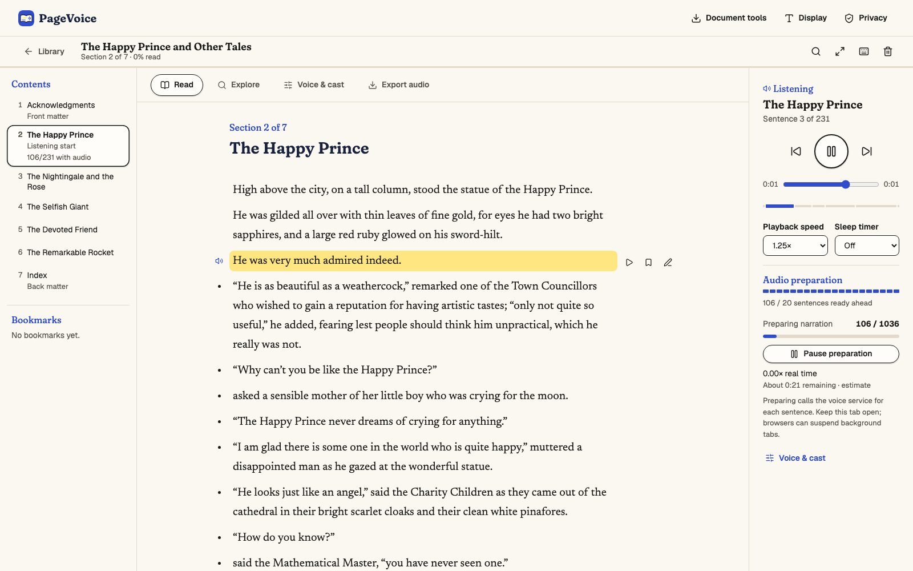

# PageVoice

PageVoice is an open-source web app for reading and listening to PDFs and EPUBs.
It runs in the browser, keeps your documents on your device, and keeps working offline
after you download a voice once.

| | |
| --- | --- |
| Website | <https://pagevoice.tech> (app at <https://pagevoice.tech/app/>) |
| Status | Open beta |
| Contact | [support@pagevoice.tech](mailto:support@pagevoice.tech) |
| Source code | This repository, MIT licensed (see [License](#license)) |



## Where to look

- **The product:** [`web/`](web/), a static site and reader app with its own tests.
- **Roadmap, including the planned Claude layer:** [`docs/roadmap.md`](docs/roadmap.md).
- **Optional Python tool** (command line and local API, not used by the website):
  `pagevoice/`, `rag/`, `tests/`, `pyproject.toml`, `Dockerfile`. Some of these must stay
  at the root for packaging and CI.
- **Archived hosted-backend experiment:** [`legacy/hosted-backend/`](legacy/hosted-backend/README.md).
  Not deployed.

## What PageVoice is

PageVoice turns a PDF or EPUB into something you can read and listen to. You import a
document, read it with sections, bookmarks and search, and play it with a local voice
that reads the text aloud, sentence by sentence. The sentence being spoken is
highlighted. The document, the reading position and the generated audio are stored in
your browser on your device.

## Who it is for

- People who want to listen to long documents, or to read and listen at the same time.
- Readers who do not want to upload a book or report to a cloud service to hear it.
- Students and researchers who need to find a passage again, with its section
  citation.
- Developers and reviewers who want to see how a document reader can run entirely in
  the browser.

## The problem

Long documents are tiring to read in one sitting, and listening is often the only
option for people who find reading difficult. Many text-to-speech services need the
whole document uploaded to a remote server. Many reading apps cannot read aloud at all.
PageVoice tries to do both in one place, without sending the document anywhere.

## What works today

- Import EPUB files and PDFs with a text layer. Scanned PDFs need an optional one-time
  OCR download.
- Read with contents, bookmarks, search within the book, themes, text size and line
  width, and focus mode.
- Listen with narration voices from ElevenLabs, served through this site. Playback speed
  from 0.5× to 2×, a sleep timer, and the sentence being spoken is highlighted.
- Search the whole book by keyword. Each result shows its section and sentence.
- Keep a library in the browser, with reading progress, and back it up or restore it
  as a ZIP file.
- Export prepared audio as MP3 files, with metadata and citations. Export as an M4B
  audiobook is available but is best effort.
- Read, search and open saved books offline. Narration needs an internet connection.

## Why local processing matters

PageVoice does most of the work on your device:

- Reading the file, detecting the language and sections, OCR, search and storage all run
  in your browser.
- The website has no server that receives your documents, and no accounts.
- Narration is the one exception. The text of each sentence you listen to is sent to
  ElevenLabs, which generates the speech. Nothing else from the book is sent, and the
  generated audio is kept in your browser, not on a server.
- The other network requests are fixed document-tool files (OCR and search models).
  Each file is checked against a pinned hash, and the page's content security policy
  blocks connections to other servers.

What this does not guarantee:

- The website is served by a hosting provider, which can log standard request details
  such as IP address and the pages requested.
- ElevenLabs processes the sentence text under its own terms and data policy. Check
  those terms before you use narration with sensitive material.
- Browser storage can be cleared by the browser or by you. Export a backup to keep a
  copy.

## How it works

1. **Import.** The browser reads the file in a background worker. It extracts the text,
   the sections, the language and, for EPUBs, the cover.
2. **Store.** The book is saved in the browser's IndexedDB. Generated audio is saved in
   the origin private file system when the browser supports it.
3. **Read and search.** The reader shows the text in sections. Search runs against an
   index built on your device.
4. **Listen.** When you press play, each sentence is sent to this site's narration
   route, which forwards it to ElevenLabs. The returned MP3 is stored in your browser.
   The player plays the sentences in order and prepares the next ones ahead of you.
5. **Keep or export.** Positions and bookmarks are saved as you go. You can export the
   library or the audio.

## Limitations

- **Open beta.** Automated browser tests pass in Chromium, and most pass in Firefox.
  Safari (WebKit) support is partial: offline reloads and some large downloads are not
  verified there. See [static verification](docs/static-verification.md) for the
  detailed test record.
- **Narration needs a connection** and a configured ElevenLabs key. The service's terms,
  limits and charges apply. Voice choice and pronunciation depend on the service.
- **Speed.** Generating a book's audio takes time, one request per sentence.
- **Accuracy.** Language detection, OCR, dialogue attribution and section detection
  can be wrong. The app shows these results so you can correct them.
- **Languages.** Narration is set up for English and Spanish text.
- **Storage.** Books live in one browser on one device. There is no sync and no
  sharing. Export a backup to move your library.
- **No generated answers.** Search finds passages. PageVoice does not summarize or
  answer questions yet.

## Roadmap and Claude

PageVoice does not use Claude or any other language model in the current product.
There is no Claude API integration, no API key, and no model call in the code.

Claude is the intended model for a planned analysis layer: source-grounded questions
with citations, summaries of chapters and themes, connecting ideas across long books,
explanations and study help, and better text preparation before narration. That layer
would be optional and off by default. Any text sent to a model would be shown to you
first. The local features would keep working without it. The full plan, including the
privacy rules and the quality bar, is in [docs/roadmap.md](docs/roadmap.md).

---

## Technical documentation

## Repository layout

```
web/                      The product: static site and reader application (React, Vite)
  index.html              Public introduction page
  app/index.html          The reader application
  src/                    Application code (see Architecture)
  e2e/                    Browser tests (Playwright)
pagevoice/, rag/          Optional Python command-line and server tool ("power mode")
tests/                    Tests for the Python package (run by CI)
scripts/                  Setup and maintenance scripts for the Python package
docs/                     Documentation, including the roadmap and verification records
legacy/hosted-backend/    Archived Docker/PocketBase experiment. Not used by the website.
vercel.json               Static hosting configuration for the website
```

## Feature reference

**Reading**

- Library with covers, author, format, page or section count, reading progress and
  last-opened time; sort, filter and "Continue reading"
- Paper, light and night themes; text size (16–32 px) and line width settings
- Contents drawer, previous/next section, bookmarks, focus mode
- Find in book (`/` or `Ctrl`/`⌘ F`): case- and accent-insensitive, highlights every
  match, `Enter`/`Shift Enter` to step through results
- Reading position is saved while you scroll or listen

**Listening**

- Narration voices come from ElevenLabs through this site's narration route. The voice
  list is loaded when you open a book. Each book keeps its own voice choice.
- The sentence being spoken is highlighted and scrolled into view
- Play/pause, previous/next sentence, playback speed 0.5–2×, sleep timer, media keys
- Audio is prepared ahead of the listening position; the buffer size is adjustable
- Export prepared chapters as an MP3 ZIP (with metadata and citations) or, best
  effort, as an M4B via single-threaded FFmpeg WASM

**Search and structure**

- Keyword search across the book with section citations, "Show in source" and
  "Listen from here"
- Detected sections (chapters, front and back matter) with confidence, reasons and
  manual correction
- Optional local meaning search (multilingual MiniLM embeddings) and character-name
  detection (multilingual NER), each an opt-in download
- No language model generates summaries or answers; every result is a passage from
  the document

**Accessibility**

- Keyboard operable throughout, with visible focus and documented shortcuts
  (`Space`, `/`, `J`/`K`, `←`/`→`, `F`, `Esc`, `?`)
- Semantic landmarks, labelled controls, tab/tabpanel semantics and live status
  regions; dialogs use native `<dialog>` with focus return
- The spoken sentence is marked by an inset bar and an icon as well as colour
- `prefers-reduced-motion` and `prefers-color-scheme` are respected
- Interface in English and Spanish, independent of the document's language

## Supported formats

| Format | Notes |
| --- | --- |
| EPUB 2 / 3 | Chapters, metadata and cover. DRM-protected or encrypted books are rejected. |
| PDF with a text layer | Sections from bookmarks and headings; repeated headers, footers and page numbers are removed and listed as review notes. |
| Scanned PDF | Needs the optional English + Spanish OCR download (Tesseract). Multi-column or damaged scans may not be reconstructed well. |

Files up to 100 MB. Language (English or Spanish) is detected automatically and can be
corrected in **Voice & cast**. Other languages are not supported for narration.

## Architecture

The reader is a static web application. Its one server-side part is a narration route
that forwards requests to ElevenLabs, keeping the API key on the server.

```
web/
  index.html          Public introduction page (static HTML)
  app/index.html      The reader application (React)
  404.html            Not-found page
  src/App.jsx         App shell, library, import feedback, dialogs
  src/ui/             Reader, player, library, display menu, find-in-book
  src/browser/        Parsing (pdf.js, xmldom), sentences, language detection,
                      section analysis, keyword search
  src/offline/        Storage, document-tool assets, narration client, playback, workers
  src/styles/         Design tokens shared by the app and the introduction page
api/                  Vercel functions: /api/tts (narration) and /api/voices
server/elevenlabs.js  The narration proxy, shared by the functions and the Vite dev server
```

- **React 19 + Vite 8.** The reader route is code-split; the startup bundle holds the
  library and shell only.
- **Narration.** The browser requests one sentence at a time from `/api/tts` and stores
  the MP3 that comes back. The API key is read from the server environment and is never
  part of the JavaScript.
- **Web Workers** do the heavy local work: `reader.worker` (parsing, OCR, analysis,
  search index), `knowledge.worker` (Transformers.js embeddings and NER), `search.worker`
  and `export.worker` (joins MP3 files, FFmpeg WASM for M4B).
- **Storage.** IndexedDB holds documents, analysis, preferences and audio bytes or
  references; audio is stored in the origin private file system (OPFS) when available.
  Document-tool model files are cached by the service worker after hash verification.
- **PWA.** `vite-plugin-pwa` precaches the app shell, fonts and runtimes, prompts before
  updating, and serves `/app/` offline.

## Privacy and network use

What the implementation does:

- Documents, reading positions, bookmarks and generated audio are stored in this
  browser's storage on this device. Session-only imports are kept in memory.
- The app has no account system and no analytics.
- Narration sends the text of each sentence you listen to through `/api/tts` to
  ElevenLabs. The request body contains only the sentence text and the voice id. Nothing
  else from the book is sent.
- Voice lists come from `/api/voices`. The browser never receives the API key.
- Document-tool downloads are fixed, SHA-256-verified files from Hugging Face and
  jsDelivr. Those requests contain no document text.
- The content security policy restricts connections to this site and those download
  hosts.

Browser tests assert that the only non-document requests the app makes are the two
narration routes.

## Offline engines and download sizes

Narration uses ElevenLabs and is not downloaded. The optional document tools are
one-time downloads, shown in **Document tools** in the app. Sizes are decimal MB for a
cold cache.

| Tool | First download | License / limitation |
| --- | ---: | --- |
| English + Spanish OCR | 25.4 MB | Apache-2.0. Needed only for scanned PDFs |
| Multilingual meaning search | 157.0 MB | Apache-2.0; inferred similarity, not evidence of an answer |
| Multilingual NER | 203.1 MB | AFL-3.0; news-domain model, fiction accuracy unmeasured |
| FFmpeg M4B | 32.3 MB | GPL/LGPL components; memory-limited browser export |

Full credits and licenses are in **Privacy & credits** in the app,
[web/LICENSES](web/LICENSES) and `/licenses/credits.html`. The original PageVoice code
is MIT licensed; third-party runtime and model licenses differ.

## Browser requirements

A current Chrome, Edge, Firefox or Safari with WebAssembly, Web Workers, IndexedDB and
ES modules. OPFS is used when available. Service workers and OPFS need HTTPS or
`localhost`. Narration needs an internet connection.

## Local development

Node **22.13.1** and npm **10.9.2** are the verified versions (see `.nvmrc`).

```sh
npm ci --prefix web
npm --prefix web run dev
```

- Introduction page: <http://127.0.0.1:5173/>
- App: <http://127.0.0.1:5173/app/>

Reading works without configuration. To test narration locally, set the key in your
shell only, never in a file that is committed:

```sh
ELEVENLABS_API_KEY=... npm --prefix web run dev
```

Narration calls go through the same routes the production site uses. `.env.example`
lists the variable names, without values.

## Production build

```sh
npm --prefix web run build     # outputs web/dist
npm --prefix web run preview   # serves it on http://127.0.0.1:4173
```

The build copies pinned runtimes into static files and does not download model weights.

## Deployment

`vercel.json` deploys the build from the repository root (Node 22, install
`npm ci --prefix web`, build `npm --prefix web run build`, output `web/dist`) and the
`api/` functions. `.vercelignore` must keep `api/` and `server/`. It sets security
headers (CSP, HSTS, `nosniff`, frame denial, permissions policy), long-term caching
for hashed assets, revalidation for HTML and the service worker, and serves
`404.html` for unknown paths.

**Narration setup.** In the Vercel project settings, add `ELEVENLABS_API_KEY` as a
**server-only** variable. Do not use a `VITE_` prefix: those values are copied into the
public JavaScript. Optional: `ELEVENLABS_MODEL_ID` (default `eleven_multilingual_v2`) and
`PAGEVOICE_ALLOWED_ORIGINS` (defaults to `https://pagevoice.tech` and
`https://www.pagevoice.tech`, plus local development origins). The narration route
accepts only those origins, caps each request at 1000 characters, and checks the voice
against the service's list. Its rate limit is per server instance; set a Vercel
Firewall rate limit for the real protection.

**Known issue.** At the time of writing, `pagevoice.tech` redirects to
`https://www.pagevoice.tech`, so the canonical links point to an address that
redirects. Choose one primary host in the Vercel domain settings, make the other
redirect to it, and update the canonical links to match. See
[static deployment](docs/static-deployment.md).

The hosted backend that appears in older notes (Docker, PocketBase, Caddy) is archived
in [`legacy/hosted-backend`](legacy/hosted-backend/README.md). The website does not use it.

## Testing

```sh
npm --prefix web test            # unit and component tests (Vitest)
npm --prefix web run lint
npm --prefix web run format:check
npm --prefix web run build
# Browser tests. Narration tests mock the /api routes, so they need no key.
# The first command caches pinned document-tool files for the OCR tests.
node web/scripts/cache-e2e-models.mjs
npm --prefix web run test:e2e
```

`web/scripts/capture-screenshots.mjs` regenerates the introduction-page screenshots and
social image from the real app. Earlier verification reports are in
[docs](docs/static-verification.md). No word-accuracy or subjective speech-quality
benchmark has been performed.

## Limits

CPU narration may prepare slower than real time; browsers can suspend background
tabs, and a closed tab stops preparing. Exports cap loaded WAV data at 256 MB and
backup import caps uncompressed data at 512 MB. Optional analysis caps 12,000 passage
windows. OCR, dialogue attribution, language detection and section classification can
need correction. Highlighting follows sentences, not individual words.

## Optional Python power mode

The `pagevoice/` and `rag/` packages are a separate, optional local command-line tool
and API with FFmpeg, Tesseract and explicit-consent online Edge narration. The website
never calls them. They have their own tests, which CI runs. They are not the hosted
service and are not deployed with the website.

```sh
bash scripts/setup.sh
.venv/bin/pagevoice inspect book.epub --language es
.venv/bin/pagevoice convert book.epub --engine edge --language es --allow-network
.venv/bin/python -m pytest -q
```

See [Python power mode](docs/python-power-mode.md).

## License

MIT for the original PageVoice code. See [LICENSE](LICENSE) and the third-party
notices above.
